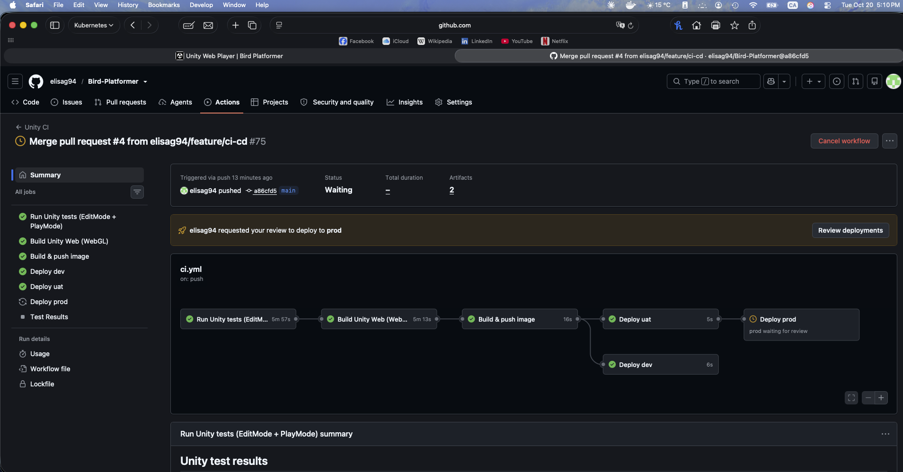

# Week 3 Day 7 — CI/CD, build once, gated promotion (20 Oct 2026)

**Mental model:** the WebGL build is the cake. The **Docker image is the cake in a sealed
box**, and the **commit SHA is the serial number stamped on it**. GHCR is the warehouse.
dev / UAT / prod are three shops that all receive the *same* box. Nobody re-bakes per shop.
`latest` is a sticker that moves from box to box, which is why it's never deployed.

```
tests → build-web → image ─┬─▶ deploy-dev                    (every run, incl. PRs)
                           └─▶ deploy-uat ─▶ deploy-prod ⏸   (main only; prod waits for approval)
```

Proof: `a86cfd5` was built once, then deployed to dev, UAT and prod. All three badges
report `{"version": "a86cfd5…"}`.



## How the pieces fit

- **Artifact vs cache.** The artifact (`web-build`) hands the finished build *between
  jobs in one run*. The cache (`Library`) keeps prepped ingredients *between runs*.
  `retention-days: 7` is only how long GitHub keeps the artifact around for people to download.
- **SHA = one fact, one home.** Workflow-level
  `env: SHA: ${{ github.event.pull_request.head.sha || github.sha }}`, used by every job.
- **Deploy jobs differ in three things only:** release name, namespace, values file.
  Same chart, same image tag.
- **GitHub Environments:** `dev`/`uat` have no rules. `prod` has a required reviewer
  (me) and only allows deploys from `main`. A workflow that names a missing environment
  **silently creates it unprotected**, so create environments before referencing them.
- **Defence in depth: three independent locks on prod.**
  1. `if: github.ref == 'refs/heads/main'` skips the job entirely.
  2. The branch rule (the bouncer) rejects non-main runs before any approval is asked.
  3. The required reviewer (the front door) means a human approves.
- **Honest limitation:** GitHub's runners can't reach minikube. The CI deploy jobs
  `helm template` the chart with the exact image (proving it renders) and print the
  `helm upgrade` command to the run summary. I run that command locally. The Week 5 EKS
  day makes it a real deploy; only the kubeconfig changes.

## Branching strategy

GitHub Flow / trunk-based: short-lived feature branches → PR (CI runs, image goes to dev)
→ merge to `main` → UAT automatically → prod after approval. The PR image is a taste test
and gets thrown away. **Build-once applies from `main` onward.** Shared dev
for other people = per-PR **preview environments** (needs a cloud cluster).
GitFlow (`develop`/`release` branches) is the heavier, older alternative.

## Symptom → cause → fix

| # | Symptom | Cause | Fix |
|---|---|---|---|
| 1 | `image` job not recognised as a job | Indented 6 spaces, so it was nested inside `build-web`'s steps | Jobs sit at 2 spaces. Check with `actionlint` |
| 2 | `needs: Upload web build` | `needs` takes a **job ID**, not a step name | `needs: build-web` |
| 3 | Download would find nothing | Artifact name used the image name (`bird-platformer`) | Must match the upload's `name: web-build`, like a claim ticket |
| 4 | `pip install yaml` → no matching distribution | The package is `pyyaml` (imported as `yaml`). Also: I was inside `api/.venv` | Don't install tools into the app's venv. Used `brew install actionlint`, which also catches bad `needs:` |
| 5 | Pushing the feature branch ran nothing | Trigger is `push: [main]` + `pull_request` | Open the PR; every push after that re-runs CI |
| 6 | Image tag `19e1c9f…` ≠ `HEAD` `b054bad…` | On `pull_request`, GitHub builds a **temporary merge commit** (branch + main). `github.sha` is that commit, which isn't in my history | Tag with `github.event.pull_request.head.sha \|\| github.sha`. Verified the next tag == `HEAD` |
| 7 | actionlint `SC2086` | Unquoted `$SHA` in `run:` (word splitting/globbing) | `"$SHA"`. Quote every variable as a habit |
| 8 | Predicted GHCR package would be private, but it was public; anonymous pull worked | Pushed by a workflow in a public repo, so the package came out public | No `imagePullSecret` needed for minikube/EKS. Private registry = the Week 2 stretch item |
| 9 | Prompt `(⎈\|N/A:N/A)` after a long break | Laptop slept, minikube stopped | `minikube start`. Checked `docker inspect minikube` memory is still 6 GiB |
| 10 | (avoided) UAT upgrade without `-f values-uat.yaml` | Helm would use dev defaults; UAT's Ingress would grab `dev.bird.local` | Always pass the env's `-f` |
| 11 | (avoided) local promotion with `$(git rev-parse HEAD)` | That's whatever is checked out, not what was approved | Paste the SHA from the run summary. Promote the *reviewed* box |
| 12 | Merge to `main` rebuilt the image (~13 min) though the game didn't change | The merge creates a new commit → new SHA → no box with that label | Before Week 5: **re-label, don't re-bake** (below) |
| 13 | Annotations: Node 20 deprecated; `ubuntu-latest` → Ubuntu 26 | Floating versions change underneath you | Cleanup: bump action majors; pin `runs-on: ubuntu-24.04` (same reason the Unity version is pinned) |

## Before Week 5 (required)

Every commit gets an image tag, but bytes are only built when that image's inputs change;
otherwise the existing digest gets a new label (`docker buildx imagetools create`). Plus a
leaderboard image in CI and separate game/leaderboard tags in Helm. Full checklist is
in the plan, Week 3 Day 7. `paths-ignore` was considered and rejected: a skipped run
leaves commits with no image and can block PRs if a check is ever required.

## Interview lines

- *"Images are tagged with the commit SHA, never `latest`, so every running pod traces to one commit."*
- *"The same image is promoted dev → UAT → prod; the deploy jobs differ only in release name, namespace and values file."*
- *"Prod is gated three ways: the job's `if:`, the environment's branch rule, and a required reviewer."*
- *"On PRs, `github.sha` is a synthetic merge commit, so I tag PR images with the head SHA."*
